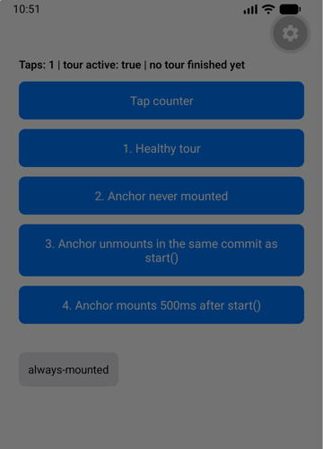
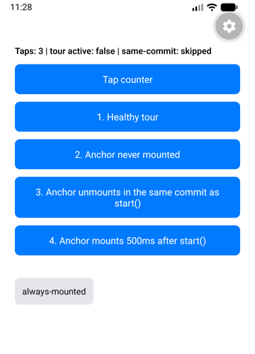

# react-native-coachmark missing anchor repro

Minimal Expo app for a bug in [`@edwardloopez/react-native-coachmark`](https://github.com/edwardloopez/react-native-coachmark) 0.5.4.

When the anchor of a tour step is missing, the tour stays up as a full-screen dim with no tooltip. With `nextOnBackdropPress: false` it swallows every tap, and only an app restart gets out of it.

## Run

```sh
npm install
npx expo start
```

Open it in Expo Go or a simulator, or press `w` for web. Checked with Expo 58 and RN 0.88 on iOS, Android and web.

## Scenarios

`Tap counter` shows whether touches reach the app. Every tour here uses `nextOnBackdropPress: false`.

| Button | What it does | 0.5.4 | `with-fix` |
|---|---|---|---|
| 1. Healthy tour | Anchor stays mounted | Works | Works |
| 2. Anchor never mounted | Step id has no `CoachmarkAnchor` | Stuck dim, no tooltip | No dim, ends as `skipped` after 2s |
| 3. Anchor unmounts in the same commit as start() | `start()` and the anchor removal are batched | Stuck dim, no tooltip | No dim, ends as `skipped` after 2s |
| 4. Anchor mounts 500ms after start() | Anchor registers after the lookup | Stuck dim, no tooltip | Spotlight and tooltip |

Reload the app after each stuck scenario. The status line shows taps, `isActive`, and the last `onFinish` reason.

| 0.5.4 | `with-fix` |
|---|---|
|  |  |

Both ran button 3 with three taps on the counter. On 0.5.4 only the first tap counts.

## Branches

- `main`: published 0.5.4, shows the bug.
- `with-fix`: same app with the proposed fix as a vendored tarball in `vendor/`. Run `npm install` again after switching.
